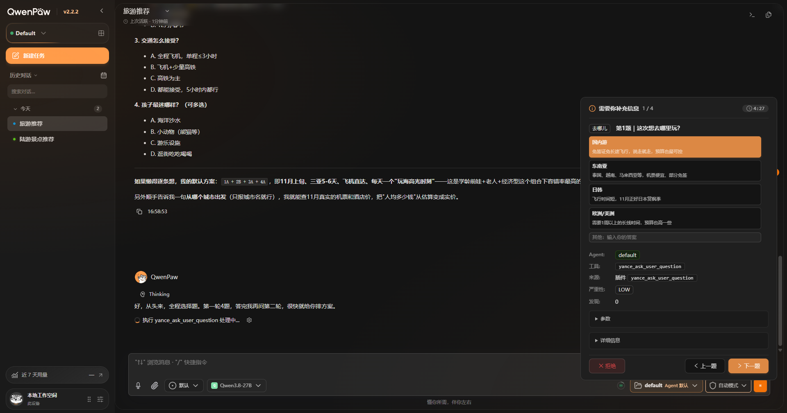
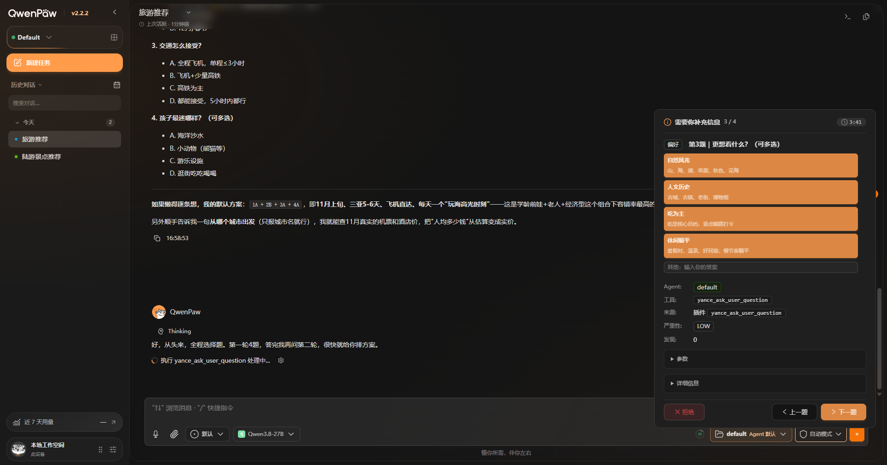
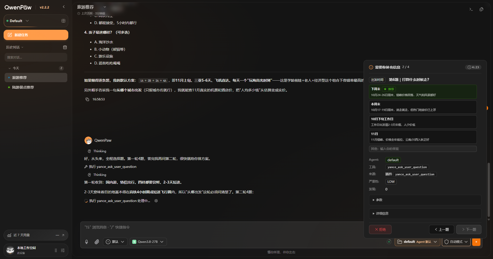
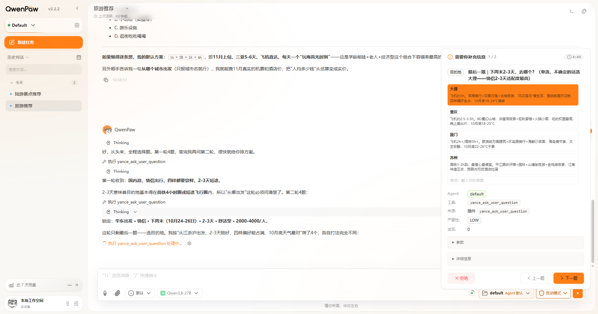
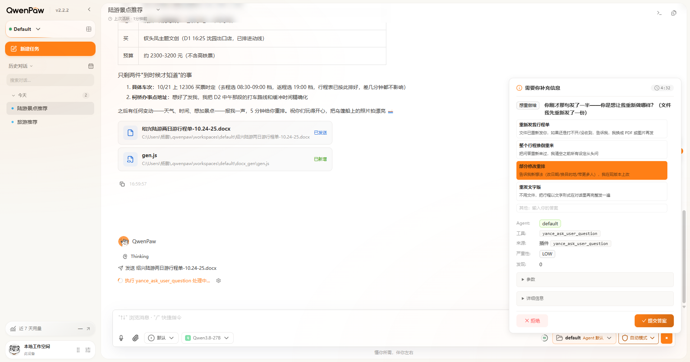
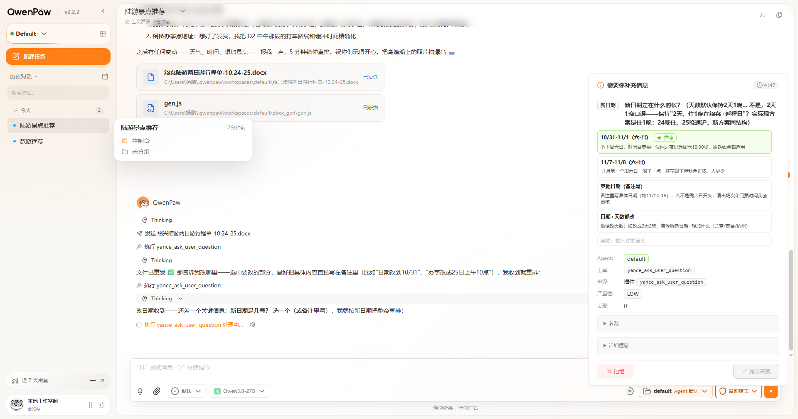

# Ask User Question by Yance：桌面效果图库

[English](yance-ask-user-question-gallery.md) | 简体中文

维护者 **Yance** 于 2026-10-15 提供以下六张 Desktop 原图，并确认重启后“详细信息”显示 **0.1.5**，
推荐高亮、图标与显示排序正常。产物及自动化证据另见[验证记录](validation/yance-ask-user-question-0.1.5.md)。
图片仅复制，没有裁剪或改图，图库位于运行 ZIP 之外。

绿色样式及星标/“推荐”徽标表示显式推荐；橙色是普通选中态，不能仅凭橙色判断推荐。
截图证明当时的可见状态，不覆盖所有状态切换、回传 metadata 或原始参数顺序。
版本归属结合维护者重启后查看详情的确认，不声称每张图都独立显示了版本。

## 1. 深色：普通单选已选中

目的地选项呈橙色，没有推荐徽标。这是单选题的已选状态，不表示该项被标记为推荐。

## 2. 深色：多选四项均已选中

同一多选题四个选项同时选中。橙色表示选择状态，图中没有独立“一键全选”功能或推荐徽标。

## 3. 深色：推荐项尚未选择

首个展示项带星标、“推荐”徽标和绿色样式；没有选中项，“下一题”禁用。
这张图显示推荐效果，但原始“参数”处于折叠状态。

## 4. 浅色：较长问题

题目换行显示，选项和翻页操作在截图窗口大小下仍可见。橙色选项为已选中，无推荐徽标；
本图不能代表所有视口尺寸。

## 5. 浅色：单题可提交状态

一个选项已选中，“提交答案”按钮可用。截图记录待点击的可提交状态，不代表已完成提交或已核对回传数据。

## 6. 浅色：推荐项无预选

首个展示项带绿色样式、星标和“推荐”徽标；没有选中项，“提交答案”禁用。

## 升级与重启核对

插件管理 API 的版本表示已安装的包，已打开的 Chat 页面可能仍加载旧前端。
应从实际问答卡的“详细信息”核对当前执行界面的版本。
两者不一致时，先完成或拒绝待答，刷新 Console 并开启新对话；
源码启动的桌面版先关闭窗口，等启动命令退出后再启动，无需重新初始化 Agent/模型配置。

已验收 ZIP 保持原字节，其中候选字样属于打包时点文字；后续维护者验收见外层验证记录及本图库。
版本源码纳入本仓库，不代表已创建 GitHub Release 或完成市场发布。

## 原图校验值

| 图库文件                                | 原文件                          | SHA-256                                                            |
| --------------------------------------- | ------------------------------- | ------------------------------------------------------------------ |
| `dark-single-choice-selected.png`       | `Screenshot_20261015170457.png` | `236aaeb32e23e59ee118de6f21c2ea3cc1e2e3593c3aa59622157f2bc11f1d44` |
| `dark-multiple-choice-all-selected.png` | `Screenshot_20261015170518.png` | `900e77fae2fb2f6df4e2a099e11de665dec616882830a1a6257baa5b0a57d396` |
| `dark-recommended-unselected.png`       | `Screenshot_20261015170713.png` | `544a946a76888ab5678e09befac47110de63e6b05b196235dbedbb5b8ec8a6ee` |
| `light-long-question-selected.png`      | `Screenshot_20261015170832.png` | `c7bdccdad7c05a2c057aad164e2f191b24205960280ccfc781d6a3305190766e` |
| `light-single-question-submit.png`      | `Screenshot_20261015170853.png` | `c2352939114d8426d1397da712a6c551b5b65852ec6e5b2d27e53f66dc86189c` |
| `light-recommended-unselected.png`      | `Screenshot_20261015171018.png` | `5f12ea7e8e8901955e9f6b96d6edb8ecfb1d90c4af47088930294c415c5f2fba` |
